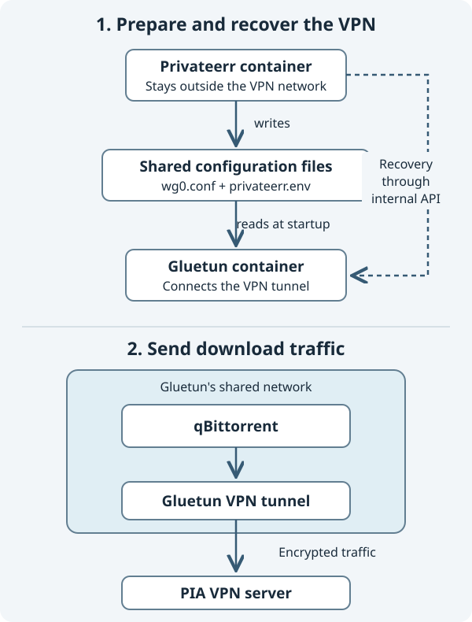

# How the containers connect

**The Privateerr container generates the PIA WireGuard configuration file. The Gluetun VPN container runs the tunnel. qBittorrent sends torrent traffic through Gluetun.** Privateerr is not a VPN tunnel and does not carry downloads.

## VPN configuration and traffic

At startup, the Privateerr container writes the PIA WireGuard configuration file (`wg0.conf`) and matching server metadata (`privateerr.env`) into a directory shared with the Gluetun VPN container. Gluetun reads them and connects to PIA. During a sustained outage, Privateerr's Python supervisor can send replacement settings to Gluetun's authenticated internal API. Rewriting a file alone does not change a running tunnel.

qBittorrent shares Gluetun's network, so its torrent traffic uses Gluetun's VPN tunnel. Privateerr stays on the ordinary project network so it can contact PIA when that tunnel is unavailable. Other applications normally remain on the project network.

Publish qBittorrent's browser port on the Gluetun service. The browser interface is local control traffic; PIA's forwarded torrent peer port arrives through the tunnel and needs no host publication. [Networking and VPN](../guides/networking-and-vpn.md) explains ports and [automatic recovery](../projects/privateerr/automatic-recovery.md) explains outage behavior.

## The media workflow

1. You or a request service asks Radarr or Sonarr for a title.
2. Prowlarr supplies indexers; the manager sends the chosen release to a download client.
3. The client downloads into the shared downloads directory.
4. The manager imports the completed files into the final movie or television library.
5. Plex or Jellyfin, when selected, scans the final library for playback.

Maraudarr generates the Compose project and exits. Plundarr is the resulting stack. Presets select services from the same catalog; they are not separate generators.

Keep matching container paths for shared downloads. For example, qBittorrent, Radarr, and Sonarr should all see the same torrent file under `/downloads/torrents/`. Host paths can differ by platform, but the application-to-application path must agree. See [connect your applications](../projects/plundarr/connect-applications.md) for the next steps.
